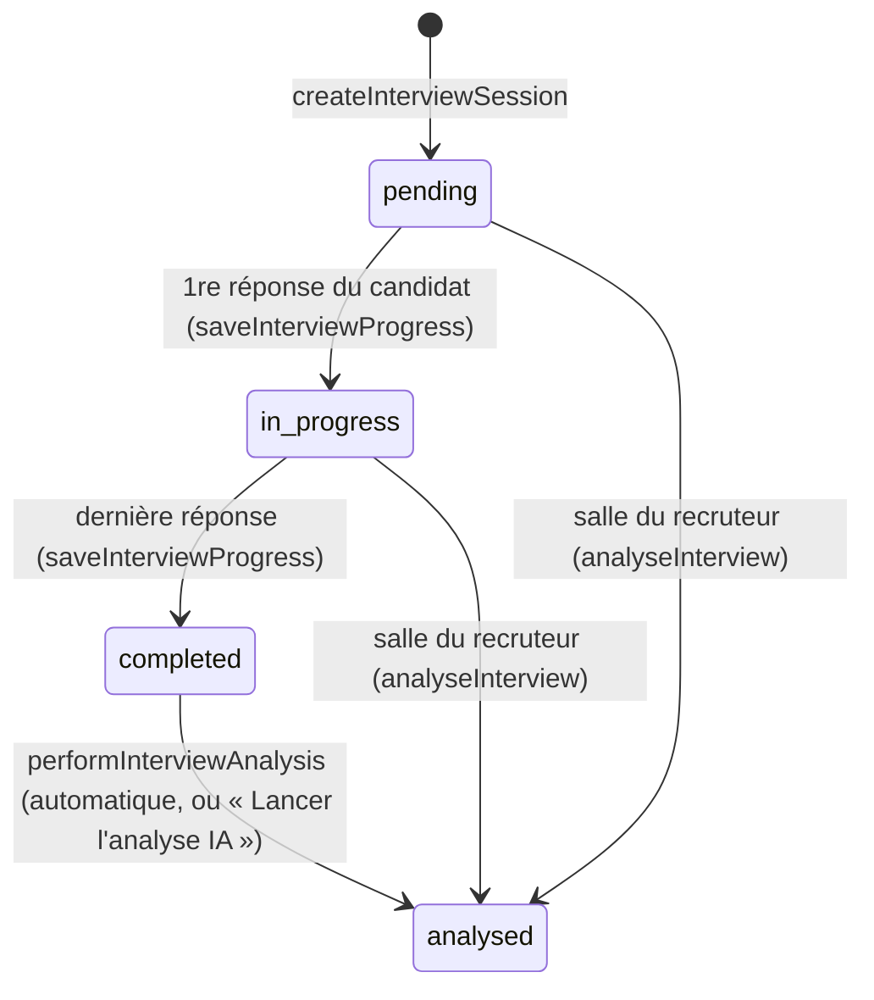

# Entretiens IA — `/recruiter/interviews`

Rubrique « Entretiens IA » du sous-menu recruteur : liste des entretiens IA de l'organisation, création d'un entretien
(questions générées par l'IA, invitation du candidat par e-mail), résultats d'un entretien (analyse de l'IA,
enregistrement, retranscription), questions génériques de l'organisation, et une salle où le recruteur mène lui-même
l'entretien. Le candidat passe l'entretien seul, sans compte, sur la page publique `/interview/<session>` (hors de ce
dossier, décrite ici parce qu'elle écrit dans la session). On arrive ici par le sous-menu, par le bouton
« Entretien IA » d'une candidature (tableau de bord, meilleurs candidats du screening), par « Voir l'entretien
complet » de la fiche candidat et par l'e-mail « Entretien terminé ».
Décisions : pas d'ADR propre ; [ADR 0023](../../../../docs/adr/0023-recruteur-affecte-identifiant-de-profil.md)
(destinataire de l'e-mail « entretien terminé »), [ADR 0027](../../../../docs/adr/0027-production-sur-vps.md)
(enregistrements envoyés directement à Appwrite). Règles produit : AGENTS.md n'a pas de section sur les entretiens ;
section « Design System », puces *Recruiter sub-menu*, *« Retour » links* et *Loading states*. Le screening des CV,
rangé dans la même rubrique, a sa propre documentation : [../screening/README.md](../screening/README.md).

## Fichiers

```
page.tsx                          /recruiter/interviews : charge les sessions, rend InterviewsIndexClient
interviews-index-client.tsx       liste (client) : recherche, filtre de statut, pagination
new/page.tsx                      /recruiter/interviews/new : pré-remplissage depuis ?appId=, rend NewInterviewClient
new/new-interview-client.tsx      création (client) : formulaire, questions à relire, envoi de l'invitation
questions/page.tsx                /recruiter/interviews/questions : charge les questions génériques
questions/questions-client.tsx    questions génériques (client) : activer, modifier, ajouter, enregistrer
[sessionId]/page.tsx              résultats d'une session (composant serveur) : analyse, enregistrements, retranscription
[sessionId]/resend-invite-button.tsx   « Renvoyer l'invitation » (client)
[sessionId]/retry-analysis-button.tsx  « Lancer l'analyse IA » (client)
[sessionId]/room/page.tsx         salle du recruteur : rend InterviewRoom
interview-room.tsx                salle du recruteur (client) : questions, réponses saisies, relances, rapport
actions.ts                        actions serveur : sessions, génération des questions, relance, analyse, reprise de l'analyse
generic-questions-actions.ts      actions serveur : questions génériques (document de l'organisation)
```

Pas de `loading.tsx` dans ce dossier : c'est celui de l'espace recruteur ([../loading.tsx](../loading.tsx),
`SectionPageSkeleton`) qui s'affiche pour toutes les sous-pages.

Code partagé :

- [interview-analysis.ts](../../../lib/interview-analysis.ts) — `performInterviewAnalysis`, analyse d'une session
  relue en base (`server-only`, sans contrôle d'appelant : chaque appelant fait le sien).
- [screening/actions.ts](../screening/actions.ts) — `sendInterviewInvitationEmail` (invitation et renvoi),
  `prepareInterviewFromScreening` (création depuis le screening).
- [`(public)/interview/[sessionId]/`](<../../(public)/interview/[sessionId]/page.tsx>) — page du candidat :
  [actions.ts](<../../(public)/interview/[sessionId]/actions.ts>) (`saveInterviewProgress`,
  `attachRecordingToInterview`, `generateInterviewSpeech`, `getCandidateAIFollowUp`, `answerClosingQuestion`,
  `reportRecordingFailure`) et [interview-room-candidate.tsx](<../../(public)/interview/[sessionId]/interview-room-candidate.tsx>)
  (déroulé, voix, reconnaissance vocale, enregistrement).
- [`/api/recording/[fileId]`](<../../api/recording/[fileId]/route.ts>) — lecture des enregistrements.
- [jobs.ts](../../../lib/appwrite/jobs.ts) — `updateApplicationStatus` ; [sourcing-core.ts](../../../lib/sourcing-core.ts)
  — `extractCVText` ; [auth.ts](../../../lib/appwrite/auth.ts) — `getCurrentUser` ;
  [llm-router.ts](../../../lib/ai/llm-router.ts) — `callLLMForModule` ; [browser-client.ts](../../../lib/appwrite/browser-client.ts)
  — `getBrowserStorage` (envoi du navigateur).
- Autres chemins de création : [pipeline/[jobId]/actions.ts](<../pipeline/[jobId]/actions.ts>)
  (`prepareInterviewAction`, `sendInterviewInviteAction`, `cancelInterviewAction`, `renameInterviewAction`) et
  [pipeline/[jobId]/interview-detail-actions.ts](<../pipeline/[jobId]/interview-detail-actions.ts>) (détail et analyse
  dans la fenêtre `InterviewDetailModal` de l'admin).
- Composants : [back-link.tsx](../../../components/recruiter/back-link.tsx),
  [pagination.tsx](../../../components/shared/pagination.tsx),
  [audio-player.tsx](../../../components/shared/audio-player.tsx) (`AudioPlayer`, `MultiTrackAudioPlayer`).

## Données

**Collection `interviews`** (`APPWRITE_COLLECTION_INTERVIEWS`, [appwrite.config.json](../../../../appwrite.config.json) :
14/16 attributs, aucune permission client, `documentSecurity` désactivé, index `idx_applicationId`). Les listes et objets
sont des chaînes JSON.

| Attribut | Contenu | Écrit par |
|---|---|---|
| `applicationId` (obligatoire, 36) | candidature liée, `''` pour un entretien créé sans candidature | `createInterviewSession` |
| `tenantId` (36) | organisation du recruteur qui a créé la session | `createInterviewSession` |
| `candidateName`, `candidateEmail`, `jobTitle` (255) | saisis ou pré-remplis à la création | `createInterviewSession` |
| `status` (50) | `pending` · `in_progress` · `completed` · `analysed` | voir le cycle de vie |
| `questions` (10 000) | `InterviewQuestion[]` : `id`, `text`, `category` (`intro`, `technical`, `behavioral`, `motivation`, `closing`), `aiGenerated` | création ; le pipeline la réécrit avant l'envoi |
| `transcript` (obligatoire, 67 000) | `TranscriptEntry[]` : `role` (`interviewer` / `candidate`), `content`, `timestamp` | page du candidat, salle du recruteur |
| `analysis` (5 000) | `InterviewAnalysis` (scores 0–100, recommandation `hire` / `consider` / `reject`, points clés, alertes, synthèse, étapes, `analysedBy`) | analyse |
| `recordings` (20 000) | `{ questionIdx, fileId, role?, mediaType? }[]` ; `questionIdx: -1` = entretien complet | `attachRecordingToInterview` |
| `completedAt` (50), `createdAt` | dates ISO | fin d'entretien, analyse de la salle ; création |
| `title` (120) | titre facultatif | pipeline seulement |
| `score` (entier) | — | aucun code |

Le type `InterviewSession` (`actions.ts`) lit aussi `jobId`, `scheduledAt` et `recordingFileId`, qui ne sont pas des
attributs de la collection : ils valent toujours `undefined`. `createInterviewSession` reçoit un `jobId` sans
l'enregistrer.

**Questions génériques** : attribut `genericQuestions` (20 000) du document de l'organisation (`tenants`), JSON
`GenericQuestion[]` (`id`, `text`, `category`, `enabled`).

**Bucket `recordings`** (`APPWRITE_STORAGE_RECORDINGS`) : permission `create("any")` (le candidat n'a pas de session),
`fileSecurity` désactivé, 500 Mo au plus par fichier, extensions `webm`, `mp3`, `wav`, `m4a`, `ogg`, `txt`.

Variables lues : celles des collections et du bucket ci-dessus, `NEXT_PUBLIC_APP_URL` (liens des e-mails, sinon
`https://mybestconsultant.fr`), `NEXT_PUBLIC_APPWRITE_ENDPOINT` / `NEXT_PUBLIC_APPWRITE_PROJECT_ID` (envoi du
navigateur), `OPENAI_API_KEY` (voix de secours, après la clé OpenAI de Config IA).

## Accès et périmètre des données

- [middleware.ts](../../../middleware.ts) renvoie vers `/login` sans cookie `mbc-session` et vers le tableau de bord
  d'un autre rôle si le cookie `mbc-role` le dit (cookies seulement) ; [layout.tsx](../layout.tsx) de l'espace
  recruteur redirige vers `/login` sans utilisateur (`getCurrentUser`) ou si son rôle n'est pas `recruiter`. Les pages liste, questions, résultats et salle refont ce contrôle ; `new/page.tsx` ne
  le refait pas (le layout et `getInterviewPrefillData` s'en chargent).
- Toutes les lectures et écritures passent par `createAdminClient()` (clé API serveur), jamais par la session.
- Périmètre : l'**organisation**. `getInterviewSessions` ne lit que les sessions de `user.tenantId` ; les pages de
  résultats et de salle cherchent la session dans cette liste et renvoient vers `/recruiter/interviews` si elle n'y est
  pas. Tous les recruteurs de l'organisation voient toutes ses sessions (aucun filtre par recruteur) et partagent les
  mêmes questions génériques.
- Côté candidat, la page `/interview/<session>` est publique : l'identifiant de la session, dans le lien de
  l'invitation, est la seule clé.
- Contrôles de chaque action serveur : tableau « Actions serveur ».

## Cycle de vie d'une session



1. **Création** — trois chemins, tous par `generateInterviewQuestions` puis `createInterviewSession` :
   `/recruiter/interviews/new` (ci-dessous) ; le screening (`prepareInterviewFromScreening`, voir
   [../screening/README.md](../screening/README.md)) ; le pipeline (`prepareInterviewAction`, qui remet aussitôt
   l'ancien statut de la candidature, supprime la session si la fenêtre est fermée sans envoi —
   `cancelInterviewAction` — et ne passe la carte dans la colonne visée qu'à l'envoi, `sendInterviewInviteAction`).
2. **Invitation** — `sendInterviewInvitationEmail` : e-mail Appwrite Messaging avec le lien `/interview/<session>`.
3. **Entretien** — le candidat répond sur `/interview/<session>` ; chaque réponse réécrit `transcript`.
4. **Fin** — dernière réponse : `completed`, puis analyse automatique et deux e-mails (organisation, candidat).
5. **Analyse** — `analysed` ; si elle a échoué, la page de résultats propose « Lancer l'analyse IA ».

Une session `completed` ou `analysed` ne peut plus être passée : la page du candidat affiche « Entretien terminé ».

## `/recruiter/interviews` — liste

**Chargement** (`page.tsx`) :

1. `getCurrentUser()` ; sans rôle `recruiter` → `/login`.
2. `getInterviewSessions()` : `interviews` filtrée sur `tenantId = user.tenantId ?? ''`, triée par `$createdAt`
   décroissant, **500 documents au plus** (`Query.limit(500)`) ; chaque document converti en `InterviewSession`
   (JSON relus ; `recordings` illisible = liste vide). Toute erreur → liste vide.
3. `InterviewsIndexClient sessions={…}`.

**Logique** (`InterviewsIndexClient`, dans le navigateur) :

- Par défaut, les sessions `pending` sont masquées (commentaire : invitations jamais démarrées ; la liste ne montre que
  les candidats passés en entretien). Une pastille de statut (`STATUS_STYLE` : « En attente », « En cours »,
  « Terminé », « Analysé IA ») ne montre que ce statut, `pending` compris ; un second clic la retire.
- Recherche : sous-chaîne, sans casse, de `candidateName + ' ' + jobTitle` (accents non normalisés).
- Recherche et pastilles ne s'affichent que s'il y a plus de 5 sessions.
- Pagination : `PAGE_SIZE = 50`, retour en page 1 à chaque changement de recherche ou de filtre. Filtres et page sont
  dans l'état du composant, pas dans l'adresse.
- Une ligne : « Vidéo » si un enregistrement a `mediaType: 'video'`, sinon « Audio » s'il y a un enregistrement ;
  « N éch. · MQ » s'il y a une retranscription ; recommandation de l'analyse (`RECO_STYLE` : « À recruter »,
  « À considérer », « À rejeter ») ; statut ; date de création. Clic → page de résultats.
- En-tête : « Screening CV » (`/recruiter/screening`), « Questions génériques », « Nouvel entretien » (`/new` sans
  candidature).

## `/recruiter/interviews/new` — création

**Chargement** (`new/page.tsx`) :

1. Paramètres `appId` (candidature) et `jobId`. Sans `appId` : formulaire vide (`EMPTY_FORM`).
2. Avec `appId` : `getInterviewPrefillData(appId)` lit la candidature, puis en parallèle l'offre et le profil du
   candidat. Résumé du CV = `applications.aiSummary`, sinon texte du CV (`extractCVText`, 3 000 caractères par défaut) ;
   nom = prénom + nom du profil ; e-mail du profil ; titre, description et compétences (jointes par « , ») de l'offre.
   En cas d'erreur : formulaire vide, sans bandeau « Pré-rempli » ni message ; `appId` reste transmis au client.

**Logique** (`NewInterviewClient`, trois étapes `config` → `questions` → `sent`) :

1. **Formulaire** : nom, e-mail, poste, compétences (séparées par des virgules), description, résumé du CV
   (facultatif), nombre de questions (curseur de 4 à 15, 8 par défaut), format « Audio » (par défaut) ou « Vidéo ».
   « Générer les questions » exige le nom et le poste ; appelle `generateInterviewQuestions` (ci-dessous).
2. **Relecture** : modifier un texte, supprimer, « Ajouter une question » (identifiant `custom-<horodatage>`, catégorie
   `technical`, texte vide) ; badge « Par défaut » pour les identifiants `gq-…`. « ← Modifier » revient au formulaire.
   Les questions au texte vide ne sont pas retirées avant l'envoi.
3. **« Envoyer l'entretien au candidat »** (désactivé sans question) : `createInterviewSession`, puis lien
   `<origine du navigateur>/interview/<session>` (`?mode=video` en vidéo), puis `sendInterviewInvitationEmail` avec
   `mediaMode`. Écran final : invitation envoyée, ou erreur de l'e-mail et lien à copier soi-même (« Copier le lien »).

### Génération des questions (`generateInterviewQuestions`, `actions.ts`)

- Modèle : module `interview` (`callLLMForModule('interview')`), c'est-à-dire la ligne « Entretiens IA » de Config IA,
  sinon le modèle par défaut, avec repli sur les autres modèles configurés (`callLLM`).
- Consigne système : un tableau JSON `{ id, text, category }` ; répartition recommandée pour `n` questions : 1 `intro`,
  `round(n × 0,35)` `technical`, `round(n × 0,30)` `behavioral` (méthode STAR), `round(n × 0,20)` `motivation`,
  1 `closing` (pour 8 : 1 + 3 + 2 + 2 + 1 = 9, le message demandant « exactement 8 »). Message : poste, compétences,
  description, résumé du CV.
- Lecture : premier `[…]` de la réponse (`/\[[\s\S]*\]/`), `JSON.parse` ; sans tableau → « Génération échouée ».
  `id` absent → `q<rang>` ; `aiGenerated: true` ; la catégorie n'est pas vérifiée.
- Les **questions génériques actives** de l'organisation (`getEnabledGenericQuestions`, `aiGenerated: false`) sont
  placées **devant** celles de l'IA : un entretien compte donc les génériques actives + `n` questions.
- Exception (IA, JSON) → `{ error: message }`, affiché sous le bouton.

### Création de la session (`createInterviewSession`, `actions.ts`)

Rôle `recruiter` exigé. Crée le document `interviews` (`ID.unique()`) : `applicationId`, `tenantId` (`''` sans
organisation), nom, e-mail, poste, `status: 'pending'`, `questions`, `transcript: '[]'`, `createdAt`. Puis
`updateApplicationStatus(applicationId, 'interview')` (commentaire : pour que le tableau de bord du candidat affiche
« Entretien » et non « En attente »), et revalide `/recruiter/interviews` et `/candidate/dashboard`. Ce chemin ne met
pas à jour le funnel de la candidature (`syncFunnelToColumn`, `logFunnelEvent` du pipeline) ; la candidature est passée
en `interview` avant l'envoi de l'e-mail, même s'il échoue.

À vérifier : sans candidature (« Nouvel entretien »), `updateApplicationStatus('')` est appelé après la création du
document. Si Appwrite refuse cet identifiant vide, l'action renvoie une erreur, l'invitation ne part pas et la session
reste `pending` (masquée de la liste) — alors que `resolveCandidateAuthId` prévoit expressément l'entretien sans
candidature. Comportement réel à confirmer sur DEV.

### Invitation (`sendInterviewInvitationEmail`, `screening/actions.ts`)

Détail dans [../screening/README.md](../screening/README.md) (« E-mails »). Destinataire : compte Auth tiré de la
candidature (`notificationUserId` : le chasseur pour un profil `hunter_profile`), sinon le premier compte Auth de
l'adresse saisie (`users.list`) ; aucun compte → « Aucun compte candidat associé à cet email ». Lien
`NEXT_PUBLIC_APP_URL` + `/interview/<session>`, `?mode=video` seulement en vidéo.

La page du candidat retient `mediaMode = mode === 'audio' ? 'audio' : 'video'` (commentaire : « Webcam by default »).
À vérifier : le choix « Audio » de `/new` et « Renvoyer l'invitation » (qui ne transmet pas `mediaMode`) produisent un
lien sans `mode`, donc ouvert en vidéo, alors que l'e-mail annonce un entretien audio. Lequel des deux est voulu ?

## `/recruiter/interviews/questions` — questions génériques

**Chargement** : rôle `recruiter` (sinon `/login`), puis `getGenericQuestions()` : `tenants.genericQuestions` de
l'organisation. Les questions par défaut (`DEFAULT_GENERIC_QUESTIONS`, `gq-1` à `gq-5`, toutes actives : présentation,
motivation, situation difficile, disponibilités et attentes salariales, « Avez-vous des questions pour nous ? ») sont
renvoyées sans utilisateur recruteur ou sans organisation, si l'attribut est vide, si son JSON n'est pas un tableau
non vide, et si la lecture échoue (sans message).

**Logique** (`GenericQuestionsClient`) : cocher / décocher (`enabled`), modifier le texte, choisir une des cinq
catégories, supprimer, ajouter (`gq-<horodatage>`, `behavioral`, active). « Enregistrer les questions » retire les
questions au texte vide puis `saveGenericQuestions` **remplace toute la liste** sur le document de l'organisation (sans
contrôle de version : le dernier enregistrement l'emporte). Une liste enregistrée vide fait revenir les questions par
défaut à la lecture suivante : pour n'en utiliser aucune, les décocher. Les questions ne servent qu'à la génération ;
les sessions déjà créées gardent leur copie.

## `/recruiter/interviews/[sessionId]` — résultats

**Chargement** (`[sessionId]/page.tsx`, composant serveur) : rôle `recruiter` (sinon `/login`), `getInterviewSessions()`
puis recherche de la session par `$id` ; absente → `/recruiter/interviews`. Tout est rendu sur le serveur, sauf les
boutons et les lecteurs audio.

**Logique** :

- En-tête : « Retour » (`BackLink`, repli `/recruiter/interviews`) ; « Dashboard candidat » →
  `/recruiter/candidates/<applicationId>` s'il y a une candidature ; « Voir la page candidat » → `/interview/<session>`
  dans un nouvel onglet (c'est la vraie page de l'entretien : la démarrer écrit dans la session) ; « Renvoyer
  l'invitation » tant que `status === 'pending'`.
- Analyse présente : score global en anneau et barres (communication, technique, motivation, fit culturel), en vert à
  70 et plus, orange à 50 et plus, rouge en dessous ; recommandation (`RECO_STYLE` : « Recommandé », « À considérer »,
  « Non recommandé ») ; synthèse, points clés, signaux d'alerte, prochaines étapes. Analyse absente : message, et
  `RetryAnalysisButton` seulement si `status === 'completed'`.
- Enregistrements (règles de `[sessionId]/page.tsx`) :
  1. S'il existe une piste complète (`questionIdx === -1`), les enregistrements `role: 'interviewer'` sont écartés
     (commentaire : la voix d'Alex est déjà mixée dans la piste complète).
  2. Vidéos (`mediaType: 'video'`) dans un lecteur `<video>` ; audios triés par `questionIdx` (tri stable : l'ordre
     d'enregistrement est gardé pour une même question).
  3. Sans piste complète et avec plusieurs audios : un seul `MultiTrackAudioPlayer` ; sinon un `AudioPlayer` par
     fichier (téléchargé sous `entretien-complet.webm` ou `entretien-q<N>.webm`).
  4. Libellés : « Entretien complet » ou « Question N » avec les 70 premiers caractères de la question.
  5. Fichiers lus par `/api/recording/<fichier>` : session `admin` ou `recruiter`, fichier relu avec la clé API et
     renvoyé en flux, en-tête `Range` transmis (lecture et avance sans tout télécharger), `Cache-Control: private,
     max-age=3600`.
- Retranscription : échanges du recruteur IA à gauche, du candidat à droite.

## `/recruiter/interviews/[sessionId]/room` — salle du recruteur

Aucune page de l'application ne pointe vers cette adresse. **Chargement** : comme la page de résultats, puis
`InterviewRoom` avec l'identifiant, le nom, le poste et les questions de la session.

**Logique** (`interview-room.tsx`, tout reste dans le navigateur jusqu'à l'analyse) :

- Le recruteur lit la question (aussi lue à voix haute par `speechSynthesis` du navigateur, `fr-FR`, vitesse 0,9, à
  chaque nouvelle question ou relance), tape la réponse du candidat et valide (« Valider » ou Ctrl+Entrée) ; ⏭ passe
  à la question suivante sans réponse.
- Validation : la question (si elle n'est pas déjà dans la retranscription) et la réponse sont ajoutées, puis
  `getAIFollowUp` (4 derniers échanges en contexte ; « null », vide ou erreur = pas de relance). Une relance proposée
  s'affiche à la place de la question, sauf si la question en cours est déjà une relance : une relance au plus par
  question.
- « Dicter » ouvre le micro et enregistre (`MediaRecorder`) en mémoire, mais rien n'est transcrit ni envoyé.
- Fin : « Analyser avec l'IA » → `analyseInterview(sessionId, retranscription, poste, [])` (compétences vides), puis
  rapport (`AnalysisReport`) ; « Télécharger le rapport » crée un fichier texte `entretien-<nom>.txt` dans le
  navigateur ; « Nouvel entretien » vide la salle (même session, rien n'est écrit).
- Rien n'est enregistré avant l'analyse. Celle-ci remplace `transcript`, `analysis`, `status` et `completedAt` de la
  session quel que soit son statut, y compris la retranscription d'un entretien passé par le candidat.

## Côté candidat : `/interview/[sessionId]`

Page publique ([page.tsx](<../../(public)/interview/[sessionId]/page.tsx>)) : document introuvable → 404 ; `completed`
ou `analysed` → écran « Entretien terminé » ; sinon `InterviewRoomCandidate`.

1. « Commencer l'entretien » démarre l'enregistrement continu, place la première question dans la retranscription et
   fait parler Alex (bienvenue puis question).
2. **Voix d'Alex** (`generateInterviewSpeech`, texte coupé à 4 000 caractères) : voix Edge `fr-FR-HenriNeural`
   (`node-edge-tts`, +15 %, délai 15 s), sinon OpenAI `tts-1` voix `onyx` (clé OpenAI de Config IA, sinon
   `OPENAI_API_KEY`), sinon voix française du navigateur (`speechSynthesis`). Le candidat peut la couper.
3. **Réponse** à la voix (reconnaissance vocale du navigateur, `SpeechRecognition` / `webkitSpeechRecognition`,
   `fr-FR`, continue) ou par écrit. **La retranscription est ce texte** : l'enregistrement audio n'est jamais transcrit
   par le serveur. Validation impossible pendant l'écoute, la réflexion ou la parole d'Alex.
4. Après chaque réponse, `saveInterviewProgress(…, 'in_progress')` réécrit toute la retranscription. Puis : réponse à
   une relance → question suivante ; question `closing` → `answerClosingQuestion` (si le candidat pose une vraie
   question, réponse d'Alex en 2 ou 3 phrases, ajoutée à la retranscription, puis fin du tour ; commentaire : la
   relance générique faisait boucler « avez-vous d'autres questions ») ; autre question → `getCandidateAIFollowUp`
   (une relance au plus).
5. Après la dernière question : arrêt et envoi de l'enregistrement, et `saveInterviewProgress(…, 'completed')`, qui
   écrit `completedAt`, lance `performInterviewAnalysis` (échec journalisé) puis envoie deux e-mails : au
   propriétaire de l'organisation (`tenants.recruiterId`, compte Auth, ADR 0023 ; bouton vers
   `/recruiter/interviews/<session>`) et au compte Auth de `candidateEmail` s'il existe (remerciement).

### Enregistrement

- Un seul `MediaRecorder` pour tout l'entretien. Flux : micro, plus la caméra en vidéo (caméra refusée → audio seul) ;
  la voix d'Alex est mixée au micro par Web Audio (`AudioContext` → `createMediaStreamDestination`) ; mixage
  impossible → micro seul.
- Format : premier pris en charge parmi `video/webm;codecs=vp9,opus`, `video/webm;codecs=vp8,opus`, `video/webm`
  (vidéo) ou `audio/webm;codecs=opus`, `audio/webm` ; 32 kbit/s audio, 80 kbit/s vidéo (commentaire : limite de taille
  des fichiers du serveur Appwrite, `_APP_STORAGE_LIMIT`, environ 28,6 Mo) ; un morceau toutes les 2 s.
- Fin : fichier `interview-<session>-candidat-complet.webm` (plus de 500 octets, sinon échec) envoyé **du navigateur
  à Appwrite** (`getBrowserStorage().createFile`, avec progression) : une Server Action ne passerait pas (corps limité à
  environ 4,5 Mo sur Vercel, commentaire du fichier et ADR 0027). Puis `attachRecordingToInterview` (4 essais, attentes
  de 1,5 s, 3 s et 4,5 s) retire les anciens enregistrements `role: 'candidate'` et ajoute
  `{ questionIdx: -1, fileId, role: 'candidate', mediaType }`.
- Échec (micro, mixage, `MediaRecorder`, fichier vide, envoi, rattachement) : `reportRecordingFailure` journalise et
  dépose `interview-<session>-ERROR.txt` dans le bucket `recordings` (commentaire : la collection n'a plus de place,
  limite de taille de ligne MariaDB) ; le candidat voit que l'enregistrement n'a pas pu être sauvegardé. L'écran de
  remerciement attend la fin de l'envoi.

## Analyse de l'IA

Deux fonctions, aux consignes et aux contrôles différents, toutes deux sur le module `interview` (avec repli) :

| | `performInterviewAnalysis` ([interview-analysis.ts](../../../lib/interview-analysis.ts)) | `analyseInterview` (`actions.ts`) |
|---|---|---|
| Appelée par | fin d'entretien du candidat, « Lancer l'analyse IA », admin (`analyzeInterview`), pipeline (`analyzeInterviewForRecruiter`) | salle du recruteur seulement |
| Retranscription | relue dans la session ; vide → « Aucune transcription à analyser » | envoyée par le navigateur |
| Consigne | message utilisateur seul : poste, échanges « Alex (recruteur) » / « Candidat » | consigne système : poste, compétences, échanges `[INTERVIEWER]` / `[CANDIDAT]` ; 5 points clés, 3 alertes, 2-3 étapes au plus |
| Lecture | clôtures de bloc de code Markdown retirées, `JSON.parse` du reste, sans validation ni borne | premier `{…}`, scores bornés à 0–100 (`Number(x) \|\| 0`), recommandation `consider` si absente, listes coupées à 5 / 3 / 3 |
| `analysedBy` | ce qu'écrit l'IA (la consigne donne « Claude AI ») | modèle qui a répondu (`provider`) |
| Écrit | `analysis`, `status: 'analysed'` | `analysis`, `status: 'analysed'`, `completedAt`, `transcript` ; un échec d'écriture est ignoré (le rapport s'affiche quand même) |
| Revalide | pipeline de l'offre de la candidature | `/recruiter/interviews` |

**Reprise** (`retryInterviewAnalysis`, bouton « Lancer l'analyse IA ») : pour une session `completed` sans analyse
(commentaire : fournisseur d'IA indisponible, clé non approvisionnée ; le recruteur n'avait aucun moyen de relancer).
Rôle `recruiter`, session relue et `tenantId` comparé à celui du recruteur (sinon « Non autorisé »), puis
`performInterviewAnalysis` ; erreur affichée sous le bouton ; succès → `revalidatePath` de la page, qui s'affiche avec
l'analyse.

## Actions serveur

Toutes les fonctions exportées de `actions.ts` et `generic-questions-actions.ts` (`'use server'`) sont des actions
serveur, appelables par une requête POST. Aucune n'a de validation par schéma.

| Action | Fichier | Rôle | Contrôles (auth, rôle, organisation, validation) | Écritures et effets |
|---|---|---|---|---|
| `getInterviewSessions` | `actions.ts` | sessions de la liste, des résultats et de la salle | rôle `recruiter` (sinon `[]`) ; `tenantId` de la session | lecture `interviews` (500 au plus) |
| `getInterviewPrefillData` | `actions.ts` | pré-remplissage de `/new` et du pipeline | rôle `recruiter` ; l'organisation de la candidature n'est pas comparée | lecture `applications`, `jobs`, `users`, fichier CV (`extractCVText`) |
| `generateInterviewQuestions` | `actions.ts` | questions d'un entretien | aucun contrôle de l'appelant | appel d'IA ; lecture des questions génériques |
| `createInterviewSession` | `actions.ts` | création d'une session | rôle `recruiter` ; candidature non rattachée à l'organisation vérifiée | création `interviews` ; `applications.status = 'interview'` |
| `getAIFollowUp` | `actions.ts` | relance dans la salle | aucun contrôle de l'appelant | appel d'IA |
| `analyseInterview` | `actions.ts` | analyse de la salle | utilisateur connecté (tout rôle) ; organisation de la session non vérifiée | appel d'IA ; mise à jour `interviews` |
| `retryInterviewAnalysis` | `actions.ts` | « Lancer l'analyse IA » | rôle `recruiter` ; `tenantId` de la session | appel d'IA ; mise à jour `interviews` |
| `saveRecordingUrl` | `actions.ts` | écrit `recordingFileId` (attribut absent de la collection) ; appelée nulle part | aucun | erreur ignorée |
| `getGenericQuestions` | `generic-questions-actions.ts` | questions génériques | rôle `recruiter` et organisation, sinon questions par défaut | lecture `tenants` |
| `saveGenericQuestions` | `generic-questions-actions.ts` | enregistrer les questions génériques | rôle `recruiter` et organisation de la session | mise à jour `tenants.genericQuestions` |
| `getEnabledGenericQuestions` | `generic-questions-actions.ts` | questions actives, pour la génération | comme `getGenericQuestions` | lecture `tenants` |
| `sendInterviewInvitationEmail` | `screening/actions.ts` | invitation et renvoi | rôle `recruiter` ; session non relue | e-mail Appwrite Messaging ; lecture `applications`, `users`, Users API |

Actions de la page du candidat (`(public)/interview/[sessionId]/actions.ts`), sans session donc sans contrôle
d'appelant : `saveInterviewProgress` (mise à jour `interviews`, analyse, deux e-mails), `attachRecordingToInterview`
(mise à jour `recordings`), `generateInterviewSpeech` (voix Edge ou OpenAI), `getCandidateAIFollowUp` et
`answerClosingQuestion` (appels d'IA), `reportRecordingFailure` (fichier dans `recordings`).

## Erreurs et cas limites

- **Liste** : une erreur de lecture, ou un JSON illisible dans `questions`, `transcript` ou `analysis` d'un seul
  document, donne une liste vide (« Aucun entretien »), sans trace. Au-delà de 500 sessions, les plus anciennes
  n'apparaissent pas, et leur page de résultats et leur salle renvoient vers la liste.
- 5 sessions ou moins, toutes `pending` : la liste affiche « Aucun entretien ne correspond à cette recherche » sans
  pastille pour montrer les sessions en attente.
- **Pré-remplissage** impossible (candidature introuvable…) : formulaire vide sans message.
- **Génération** : erreur de l'IA ou réponse sans tableau JSON → message rouge sous le bouton ; rien n'est créé.
- **Invitation** non envoyée : la session existe déjà et la candidature est déjà `interview` ; l'écran final donne
  l'erreur et le lien à copier.
- **Candidat qui recharge la page** pendant l'entretien : il repart de la première question et sa réponse suivante
  réécrit toute la retranscription ; la session reste ouverte tant qu'elle n'est pas `completed`.
- Les erreurs d'écriture de `saveInterviewProgress` sont ignorées. Tailles maximales : `transcript` 67 000 caractères,
  `questions` 10 000, `analysis` 5 000, `recordings` 20 000.
- **Analyse automatique** en échec : journalisée (« Auto-analyse échouée… »), session `completed`, reprise par le
  bouton. E-mails de fin en échec : journalisés, sans effet sur la session.
- **Salle** : une analyse en échec ramène à l'écran « Entretien terminé » sans message.
- **Questions génériques** : si la lecture échoue, les questions par défaut s'affichent ; les enregistrer remplace
  alors la liste de l'organisation. Erreur d'enregistrement (liste au-delà de 20 000 caractères…) : message d'Appwrite.
- Recruteur sans organisation : sessions créées et lues avec `tenantId = ''`.

## Tests

Aucun test propre aux entretiens. Couvrent cette rubrique :
[recruiter-nav.test.ts](../../../lib/recruiter-nav.test.ts) (rubrique « Entretiens IA » mise en surbrillance sur
`/recruiter/interviews/*` et `/recruiter/screening/*`) et [recruiter-trail.test.ts](../../../lib/recruiter-trail.test.ts)
(noms des pages pour « Retour »).

```
npm test                                                   # tous les tests (node:test + tsx, src/**/*.test.ts)
node --import tsx --test src/lib/recruiter-trail.test.ts   # un seul fichier
npm run typecheck
```

## Modifier cette page

- **Nouvelle sous-page** : son nom dans `PAGE_LABELS` de [recruiter-trail.ts](../../../lib/recruiter-trail.ts) (une
  sous-page fixe avant `[^/]+`) et dans son test ; la rubrique reste en surbrillance par le préfixe
  (`RECRUITER_SECTIONS`, [recruiter-nav.ts](../../../lib/recruiter-nav.ts), où `also` rattache `/recruiter/screening`).
- **Chargement** : sans `loading.tsx` ici, toutes les sous-pages ont la forme de liste de `SectionPageSkeleton` ; un
  `loading.tsx` propre se construit dans [page-skeletons.tsx](../../../components/recruiter/page-skeletons.tsx).
- **Types partagés** : `InterviewSession`, `InterviewQuestion`, `TranscriptEntry`, `InterviewAnalysis` (`actions.ts`)
  sont importés par la page du candidat, le pipeline, le screening et la fiche candidat ; `InterviewDetail`
  ([admin/interviews/actions.ts](../../admin/interviews/actions.ts)) redécrit l'analyse, sans `communicationScore`.
- **Format de l'analyse** : changer les deux fonctions d'analyse et tous ses lecteurs — page de résultats, rapport de
  la salle, liste (`RECO_STYLE`), fiche candidat (`INTERVIEW_RECO`, [candidates/[applicationId]/page.tsx](<../candidates/[applicationId]/page.tsx>)),
  fenêtre du pipeline (`InterviewDetailModal`). Les libellés de recommandation diffèrent d'un écran à l'autre.
- **Statut** : `STATUS_STYLE` de la liste, `AdminInterviewRow['status']`, écran de fin de la page du candidat
  (`completed` / `analysed`), boutons de la page de résultats (`pending`, `completed`).
- **Création** : `generateInterviewQuestions` et `createInterviewSession` servent aussi au screening et au pipeline ; un
  changement de règle (questions génériques, statut de la candidature) touche les trois chemins.
- **Nouvel attribut** sur `interviews` : [appwrite.config.json](../../../../appwrite.config.json) puis `schema:push`
  (AGENTS.md, « Structure Appwrite ») ; 14/16 attributs, mais le commentaire de `reportRecordingFailure` signale la
  limite de taille de ligne MariaDB.
- **Libellés ou parcours** modifiés : mettre à jour [knowledge.ts](../../../lib/assistant/knowledge.ts) (contenu d'aide
  de l'assistant, ligne « Entretiens IA »).
